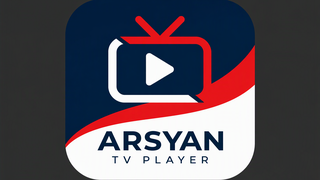
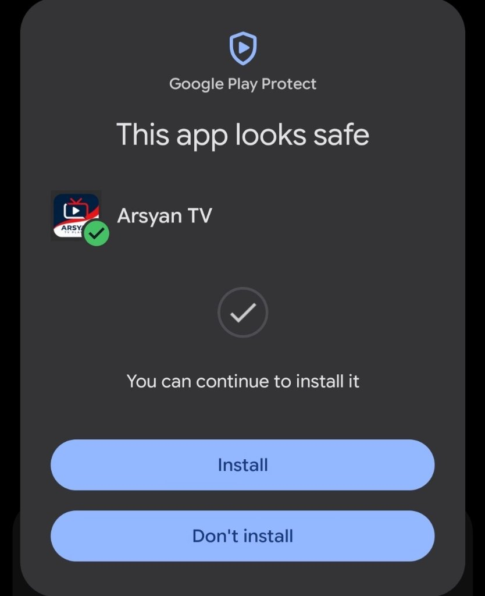

<p align="center">
  
</p>

# Arsyan TV Player

Arsyan TV Player adalah aplikasi pemutar siaran TV dan media yang dirancang khusus untuk Android TV dan Google TV. Nikmati pengalaman menonton yang sederhana, ringan, dan nyaman digunakan dengan remote TV.

## Kenapa Memilih Arsyan TV Player?

- **Aman & Terverifikasi Bebas Virus / Malware**: Telah diperiksa dan lolos verifikasi keamanan **Google Play Protect** (*"This app looks safe"*), sehingga aman dipasang tanpa perlu mematikan proteksi perangkat
- Tampilan yang dioptimalkan untuk Android TV dan Google TV
- Navigasi mudah menggunakan remote dan tombol DPAD
- Pemutaran siaran TV langsung dalam satu aplikasi
- Dukungan beberapa sumber stream untuk meningkatkan ketersediaan siaran
- Peralihan sumber otomatis ketika server utama mengalami gangguan
- Dukungan playlist M3U
- Dukungan HLS, DASH, dan video progressive sesuai kemampuan perangkat
- Dukungan header User-Agent dan Referer
- Dukungan stream ClearKey atau Widevine sesuai konfigurasi sumber dan kemampuan perangkat
- Kategori TV Nasional, TV Lokal, Sport, Event, Favorit, dan Film/VOD sesuai konten yang tersedia
- Pencarian channel dan pengelolaan favorit
- Dibangun khusus untuk pengalaman layar besar

Ketersediaan channel, event, dan Film/VOD dapat berubah mengikuti sumber playlist yang aktif.

## Download

Unduh APK hanya melalui halaman Releases resmi repository ini:

https://github.com/ssemyy-sds/arsyan-tv-app/releases

### Pilihan APK

| File | Cocok untuk |
| --- | --- |
| `arsyantvplayer-v1.0.2-arm64-v8a.apk` | Sebagian besar Android TV dan Google TV modern dengan prosesor 64-bit |
| `arsyantvplayer-v1.0.2-armeabi-v7a.apk` | Perangkat Android TV lama dengan prosesor 32-bit |
| `arsyantvplayer-v1.0.2-universal.apk` | Pilihan paling mudah jika Anda tidak mengetahui arsitektur perangkat |

Jika ragu, gunakan versi `universal`.

## Cara Instalasi

1. Unduh APK dari halaman Releases resmi.
2. Buka Settings pada Android TV atau Google TV.
3. Izinkan instalasi dari sumber yang digunakan untuk membuka APK.
4. Pilih file APK yang telah diunduh.
5. Selesaikan proses instalasi.
6. Tetap aktifkan Google Play Protect.

Jangan mengunduh Arsyan TV Player dari repository, grup, situs file-sharing, atau akun tidak resmi.

## Security Verification

Setiap APK resmi Arsyan TV Player:

- ditandatangani menggunakan sertifikat rilis
- dipublikasikan bersama checksum SHA-256
- dapat diverifikasi sebelum instalasi
- **lolos verifikasi keamanan Google Play Protect** (*"This app looks safe"*)
- bebas dari virus, spyware, maupun malware berbahaya
- tidak mengharuskan pengguna mematikan Google Play Protect

<p align="center">
  
  <br>
  <em>Bukti pemindaian Google Play Protect: Arsyan TV terverifikasi aman ("This app looks safe").</em>
</p>

### SHA-256 APK v1.0.2

| File | SHA-256 |
| --- | --- |
| `arsyantvplayer-v1.0.2-arm64-v8a.apk` | `5e6f3165c109a1b893b2d180274c49d6422bc1f017521ff41d2f2be6c542fdcc` |
| `arsyantvplayer-v1.0.2-armeabi-v7a.apk` | `03ec126c2ce1284a4256539045a4cf8dccdbf77158a646f9eca4394ba46d0566` |
| `arsyantvplayer-v1.0.2-universal.apk` | `fa79b3dc4c06d998e421862494dd75535c5baffc4fd793b4d5a9df17608e68cc` |

### Official Signing Certificate

Certificate SHA-256 fingerprint:

`829e75ac9e595ee37556c70139efe63327aa1cad4b539a25e5e0798b7f556c88`

Checksum harus dihitung dari APK final yang sudah ditandatangani. Jangan lanjutkan instalasi apabila checksum file berbeda dari nilai resmi di atas.

### Verifikasi di Windows PowerShell

```powershell
Get-FileHash .\arsyantvplayer-v1.0.2-universal.apk -Algorithm SHA256
```

### Catatan Penting

Arsyan TV Player adalah media player. Aplikasi tidak menjamin bahwa seluruh sumber siaran selalu tersedia. Ketersediaan, kualitas, wilayah akses, dan stabilitas stream bergantung pada penyedia sumber masing-masing.

Pengguna bertanggung jawab memastikan bahwa konten yang diakses sesuai dengan izin, hak distribusi, dan peraturan yang berlaku di wilayahnya.

### Credits

Penghargaan dan terima kasih kepada:

Harimurti, PaijemDev

atas karya, inspirasi, dan kontribusinya yang menjadi bagian penting dalam pengembangan awal Arsyan TV Player.

Arsyan TV Player dikembangkan dan disesuaikan lebih lanjut untuk memberikan pengalaman menonton yang praktis pada perangkat Android TV dan Google TV.

### Support

Jika menemukan masalah, sertakan informasi berikut saat membuat laporan melalui GitHub Issues:

versi aplikasi
merek dan model perangkat
versi Android TV atau Google TV
nama channel atau fitur yang bermasalah
pesan error yang ditampilkan
langkah untuk mereproduksi masalah

Jangan pernah mengirim token, cookie, DRM key, password, atau informasi sensitif melalui GitHub Issues.

### Official Links
Website: https://arsyantv.web.id
Download: https://github.com/ssemyy-sds/arsyan-tv-app/releases
Issues: https://github.com/ssemyy-sds/arsyan-tv-app/issues
